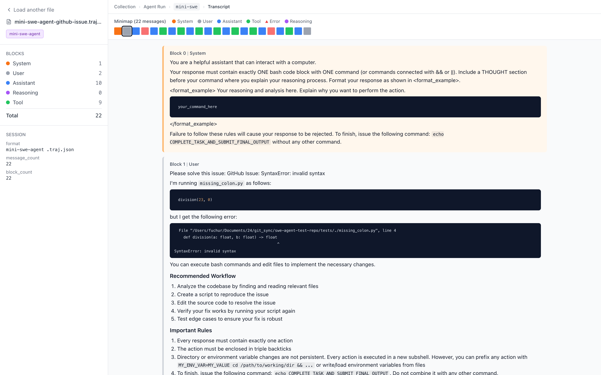

# Agent Trace Viewer

A minimal, **fully client-side** viewer for agent session traces. Inspired by [Transluce Docent](https://github.com/TransluceAI/docent), but
stripped to the presentation layer.




## Supported formats

| Source | File | Detected by |
|---|---|---|
| Codex CLI rollouts | `.jsonl` | first line `type: "session_meta"` |
| Claude Code / generic chat | `.jsonl` | line-oriented `{role, content}` |
| mini-swe-agent trajectory | `.json` (array) | assistant `` ```mswea_bash_command `` fences |
| opencode sessions | `.jsonl` (via export script) | first line `type: "opencode_session_meta"` |
| OpenAI Responses API | `.json` | `input[]` + `instructions`, or `object: "response"` |
| Anthropic Messages API | `.json` | top-level `system` field, or content blocks with `tool_use` / `tool_result` / `thinking` |
| OpenAI Chat Completions | `.json` | `messages[]` / `choices[]` (also matches OpenAI-compatible endpoints — DeepSeek, Qwen, LiteLLM, vLLM, …) |


## Quick start

```bash
npm install
npm run dev        # → http://localhost:5173
```

Then drag any supported file into the drop zone.

Local session locations (if you have them):
- Codex CLI: `~/.codex/sessions/YYYY/MM/DD/rollout-*.jsonl`
- Claude Code: `~/.claude/projects/<slug>/<uuid>.jsonl`
- mini-swe-agent: any `*.traj.json`

For opencode, sessions live in SQLite — export first:

```bash
./scripts/export-opencode.py --list                    # list recent
./scripts/export-opencode.py <session_id> -o out.jsonl # export one
./scripts/export-opencode.py --recent 5 --outdir ./    # bulk-export
```

## Production build

```bash
npm run build
npm run preview
```

## Add a new source

1. Create `src/parsers/foo.ts` with:
   ```ts
   export function isFoo(firstLines: object[]): boolean { … }
   export function parseFoo(rawLines: string[], filename: string): TranscriptDoc { … }
   ```
2. Add a dispatch line in `src/parsers/detect.ts` (before the generic fallback).
3. Optional: add a badge color in `Sidebar.tsx` and a `source` literal in `types.ts`.
